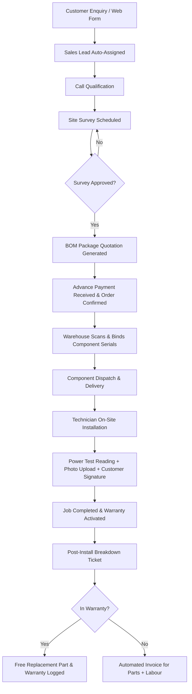

# ☀️ Solar Installation Management System (SunPower Solutions)

> **An all-in-one Enterprise Resource Planning (ERP) & Field Operations platform designed specifically for rooftop solar EPC companies — managing the entire lifecycle from initial web inquiry to 20-year solar panel warranty.**

---

## 📖 Project Overview

Rooftop solar installations involve complex, cross-functional operations: technical feasibility surveys, custom Bill of Materials (BOM) creation, government subsidy tracking, serialised inventory dispatch (panels, inverters, batteries), on-site installation with proof of power generation, customer handover signatures, and long-term warranty and breakdown servicing.

Traditional generic ERPs or fragmented spreadsheets lead to costly communication breakdowns, such as quoting before site feasibility approval, misplacing high-value serialised assets, delayed milestone billing, or untracked warranty liabilities.

The **Solar Installation Management System** solves these challenges by enforcing a streamlined, rule-based workflow across sales, engineering, warehouse, field operations, customer support, and finance in a single unified platform.

---

## 💡 How It Is Useful & Value for Stakeholders

| Stakeholder / Role | Key Challenges Addressed | System Benefits & Impact |
|---|---|---|
| **Customers & Homeowners** | Long delays, lack of transparency on warranty, lost physical paperwork. | • Online self-service inquiry portal (`/enquiry`).<br>• Instant serial number warranty verification (`/warranty`).<br>• Fast breakdown ticketing and transparent service billing. |
| **Sales Executives** | Misquoting before roof verification, manual pricing mistakes, lost leads. | • Automated lead ingestion and load-balanced round-robin assignment.<br>• Strict system gate: **Quotation is locked until site survey is approved**.<br>• Automatic Bill of Materials (BOM) generation from pre-engineered package templates (1 kW to 5 kW on-grid/off-grid). |
| **Survey Technicians** | Inconsistent site data, lost paper survey sheets. | • Mobile-first survey checklist (shadow-free area, roof angle, electrical service rating, phase type, structural strength).<br>• Instant survey pass/fail decision with clear recommendation logs. |
| **Warehouse Managers** | Misallocated components, missing serial numbers, warranty claim disputes. | • Serialised asset tracking down to individual solar panels, inverters, and battery cells.<br>• QR code label generation and built-in camera barcode scanning.<br>• Dispatch validation: rejects duplicate, mismatched, or already assigned units. |
| **Installation Technicians** | Disputed installation completions, missing power test metrics. | • Digital field worksheet: records installation times, system capacity, and power test watt readings.<br>• Mandatory photo proof upload and on-screen HTML5 digital customer signature before job sign-off. |
| **Service Managers** | Difficulty verifying if failed equipment is within warranty; revenue loss on spare parts. | • Real-time serial warranty validation (e.g., 24 months for inverters/batteries, 240 months for panels).<br>• Automated warranty cost routing: Free replacements for in-warranty items vs. automated spare parts/labor invoices for out-of-warranty repairs. |
| **Accountants** | Uncollected milestone payments, delayed government subsidy claims, difficult labor accounting. | • Milestone invoicing (advance payment required before warehouse dispatch).<br>• Centralized government subsidy tracking dashboard.<br>• Automatic technician payroll calculations based on recorded job hours and hourly rates. |
| **Directors & Executives** | Lack of visibility into real job profitability and company financial health. | • Real-time Executive KPI dashboard: revenue, expenses, net profit, open jobs, open repair tickets, and low-stock alerts.<br>• True per-job profitability (Revenue minus BOM cost, technician labor, and warranty expenses).<br>• Secure, time-limited, revocable 7-day shareable report links for external stakeholders. |

---

## 🛠️ Tech Stack

- **Backend Framework**: Python 3.12, [Flask 3.x](https://palletsprojects.com/p/flask/)
- **Database**: SQLite 3 with enforced foreign keys, relational constraints, and transaction safety
- **Frontend / Templating**: Jinja2, Semantic HTML5, Responsive Custom CSS3
- **Interactive UI**: Vanilla JavaScript, HTML5 Canvas API (digital signature pad), WebRTC Camera Stream (QR code scanning)
- **Asset Identification & QR Codes**: [Segno](https://github.com/heuer/segno) (high-speed pure-Python QR code generator)
- **Testing**: End-to-end business flow test suite (`tests/test_flow.py`)
- **Containerization**: Docker (Python 3.12-slim base image)

---

## 👥 Demo User Accounts & Roles

All demo accounts use the standard password: **`demo123`**

| Role | Email | Password | Landing Page | Access Permissions |
|---|---|---|---|---|
| **Admin** | `admin@sunpower.test` | `demo123` | `/dashboard` | Complete system access: manage users, edit pricing, configure package templates, view all data |
| **Director** | `director@sunpower.test` | `demo123` | `/dashboard` | High-level analytics: cash flow, net profit, shareable executive reports, CSV exports, orders, service, accounts |
| **Sales Executive** | `sales@sunpower.test` | `demo123` | `/leads` | Lead management, qualification calls, survey requests, quotation generation, order confirmation |
| **Survey Technician** | `survey@sunpower.test` | `demo123` | `/surveys` | Assigned site surveys, feasibility check forms, roof dimensions, electrical connection analysis |
| **Warehouse Manager** | `warehouse@sunpower.test` | `demo123` | `/warehouse` | Inventory stock management, QR label printing, camera serial scanning, dispatch validation |
| **Installation Technician** | `installer@sunpower.test` | `demo123` | `/jobs` | Field installation jobs, power test reading entries, rooftop photo uploads, customer digital signature pad |
| **Service Manager** | `service@sunpower.test` | `demo123` | `/tickets` | Customer support breakdown tickets, serial lookup, warranty validation, replacement dispatch |
| **Accountant** | `accountant@sunpower.test` | `demo123` | `/accounts` | Invoices, customer payments, business expenses, technician labor payroll, government subsidy tracker |

### 🌐 Public Endpoints (No Authentication Required)
- **Interactive Landing Page**: `http://localhost:5000/` (or `/landing`) — Full-featured public homepage with Solar Savings Calculator, package catalogue, interactive 4-step workflow, and 1-click role demo login cards.
- **Customer Inquiry Page**: `http://localhost:5000/enquiry` — Public web form where prospective clients submit rooftop solar inquiries (pre-filled when coming from the calculator or package cards).
- **Warranty Verification**: `http://localhost:5000/warranty` — Public lookup tool for customers to check the active warranty status of their serial numbers.

---

## 🔄 End-to-End Business Flow



---

## 🚀 Key System Features & Business Logic

### 1. Smart Lead Capture & Survey Qualification Gate
- Captures inquiries from web forms, WhatsApp, or phone calls.
- Auto-allocates new leads to the least-burdened sales executive.
- **Hard Gate**: Sales cannot issue a quotation until a certified technician completes and approves the site survey (verifying shadow-free area, structural stability, and grid compatibility).

### 2. Pre-Configured Package Templates & Dynamic Bill of Materials (BOM)
- Includes ready-to-use packages (e.g., On-Grid 1–5 kW, Off-Grid 1–5 kW, Panel Sets).
- Automatically explodes package definitions into a detailed Bill of Materials: panels, inverters, charge controllers, mounting structures, AC/DC distribution boxes, cables, earthing rods, and lightning arrestors.

### 3. Serial Number Lifecycle & QR Barcode Dispatch
- High-value solar components (panels, inverters, batteries) are tracked by unique serial numbers.
- Integrated camera scanner in warehouse dispatch verifies that the exact scanned serial matches the pick list and has not been dispatched elsewhere.
- Generates print-ready QR code labels.

### 4. Field Technician Digital Worksheet
- Mobile-optimized interface for on-site technicians.
- Captures start/end timestamps, actual installed system capacity, and live power generation test readings (kW).
- Prevents job completion without at least one uploaded site photo and the customer's on-screen digital signature.

### 5. Automated Warranty & Service Ticketing
- System records warranties by product category (e.g., 240 months for solar panels, 24 months for inverters/batteries).
- Tickets automatically flag whether the customer's equipment is within the active warranty window.
- Out-of-warranty claims automatically generate a payable service invoice for parts and labor.

### 6. Profit & Loss (P&L) and Milestone Financials
- Calculates real-time job-level profit:
  $$\text{Net Profit} = \text{Invoiced Revenue} - (\text{BOM Component Cost} + (\text{Technician Hours} \times \text{Hourly Rate}) + \text{Job Expenses})$$
- Tracks government subsidy claims across stages (applied, inspection scheduled, credited).
- Generates read-only executive report links with 7-day expiration and instant revocation.

---

## 💻 Installation & Setup Guide

### Prerequisites
- Python 3.10+ (Python 3.12 recommended)
- Git

### 1. Clone the Repository
```bash
git clone https://github.com/kruthikroshan/Solar-Installation-Management-System.git
cd Solar-Installation-Management-System
```

### 2. Create and Activate a Virtual Environment
- **On Windows (PowerShell)**:
  ```powershell
  python -m venv .venv
  .venv\Scripts\Activate.ps1
  ```
- **On Linux / macOS**:
  ```bash
  python3 -m venv .venv
  source .venv/bin/activate
  ```

### 3. Install Dependencies
```bash
pip install -r requirements.txt
```

### 4. Run the Application
```bash
python app.py
```
Open your browser and navigate to **`http://localhost:5000`**.  
*(The SQLite database and demo data are automatically seeded on first launch).*

### 5. Run the Automated Test Suite
To verify all business constraints, permissions, and workflow transitions:
```bash
python tests/test_flow.py
```

### 6. Reset or Rebuild Demo Data
To reset the database back to clean demo data at any time:
```bash
python manage.py reset
```

---

## 🐳 Docker Deployment

You can build and run the application container using Docker:

```bash
# Build Docker image
docker build -t solar-erp .

# Run container on port 5000
docker run -d -p 5000:5000 --name solar-erp-app solar-erp
```
Access the application at `http://localhost:5000`.

---

## 📂 Project Structure

```
Solar-Installation-Management-System/
├── app.py                  # Flask web application, routing, auth sessions & view handlers
├── services.py             # Core business rules (qualification gate, BOM explosion, dispatch, P&L)
├── db.py                   # SQLite schema, seed data, database helper methods
├── manage.py               # CLI utilities (reset database, seed demo data)
├── requirements.txt        # Python library dependencies (Flask, segno)
├── Dockerfile              # Docker container build definition
├── static/
│   ├── app.js              # HTML5 signature pad & camera QR scanner handlers
│   └── style.css           # Clean, responsive user interface styling
├── templates/              # Jinja2 HTML templates for all roles and workflows
│   ├── base.html           # Base layout with navigation and role badge
│   ├── dashboard.html      # Director executive KPI metrics & charts
│   ├── leads.html          # Sales lead tracking & assignment
│   ├── surveys.html        # Site survey checklist & feasibility review
│   ├── quote.html          # Package quotation & BOM lines
│   ├── warehouse.html      # Serial inventory & QR scan dispatch
│   ├── job.html            # Installer worksheet, photo upload & signature
│   ├── tickets.html        # Helpdesk breakdown tickets & warranty tracking
│   ├── accounts.html       # Invoices, payments, subsidies & payroll
│   └── enquiry.html        # Public customer inquiry page
├── tests/
│   └── test_flow.py        # Automated end-to-end integration and role permission tests
└── docs/
    └── DEMO_SCRIPT.md      # Step-by-step hackathon and walkthrough demo script
```

---

## 🛡️ License

This project is distributed under the MIT License. Feel free to use and adapt it for rooftop solar operations.
